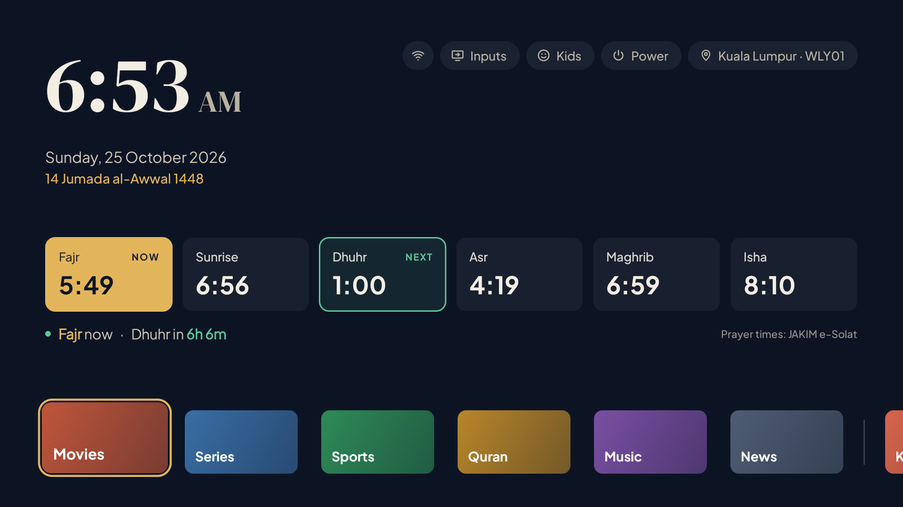
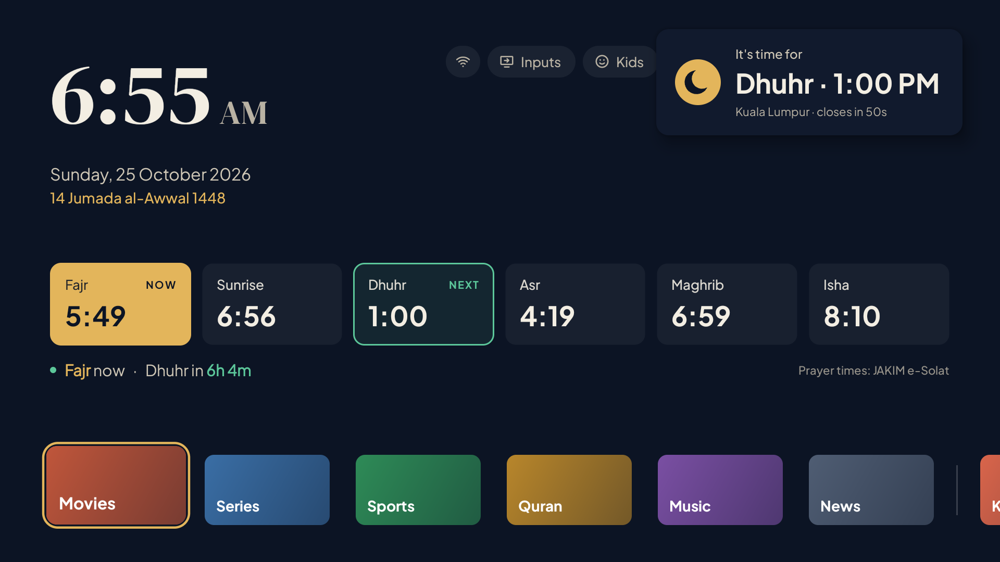
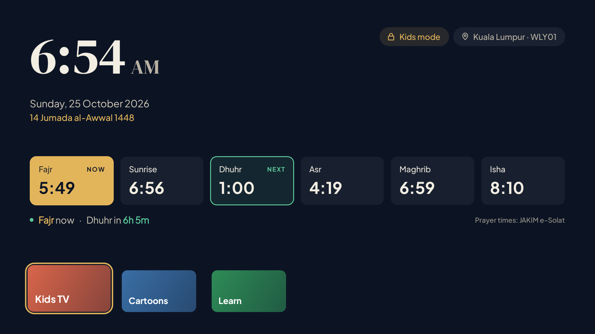
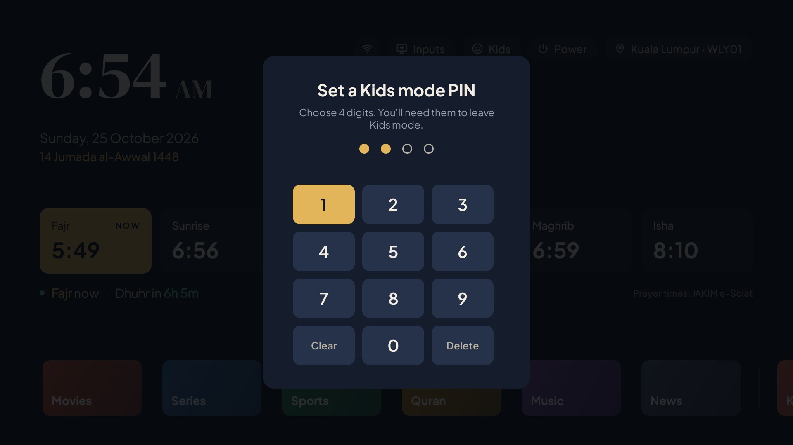
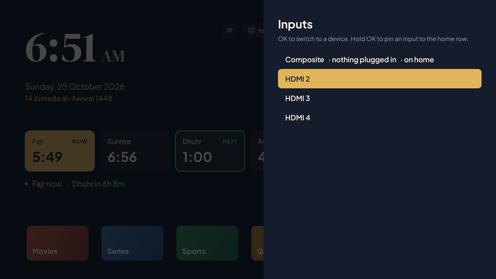
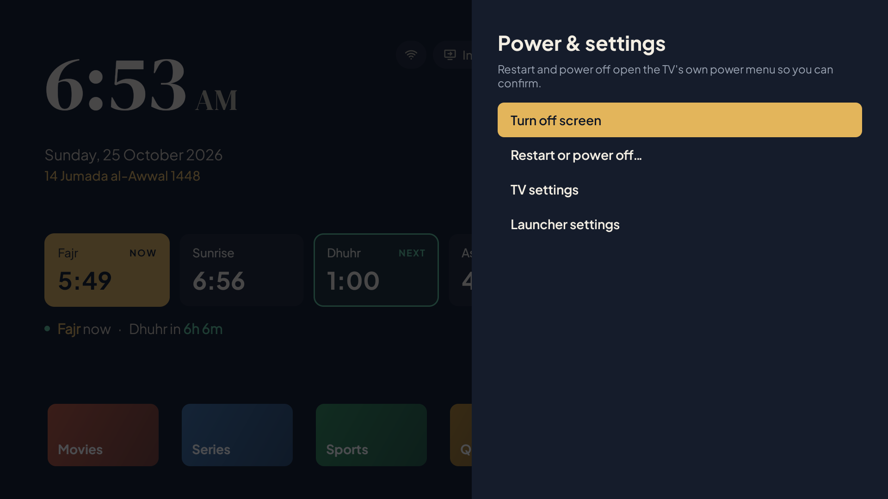
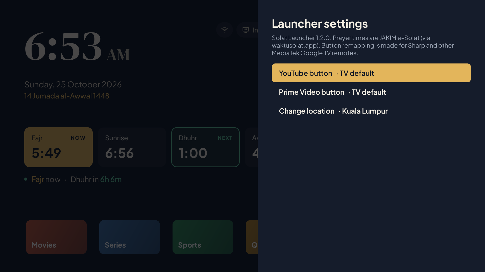

# Solat Launcher

A calm home screen for Android TV and Google TV with **Malaysian prayer times built in**. Your TV shows today's waktu solat, what's on now, what's next, and a gentle reminder when each prayer begins, right above your apps.



**[Download the latest APK](../../releases/latest)** · Free, open source, no ads, no tracking.

## Prayer times from JAKIM

All prayer times are the **official JAKIM e-Solat times** published by Jabatan Kemajuan Islam Malaysia for each zone. They are not calculated by this app. Solat Launcher fetches them through [waktusolat.app](https://waktusolat.app), a free service that relays JAKIM's e-Solat data, and keeps a month at a time on the TV so the times still show when the internet is down.

- Source: [JAKIM e-Solat](https://www.e-solat.gov.my)
- All 60 JAKIM zones are supported, from Perlis to Sabah and Sarawak.
- The home screen always shows "Prayer times: JAKIM e-Solat" so you know where the times come from.

If your local mosque announces a different time, follow the mosque.

## Features

- **Today's prayers at a glance.** The current prayer is highlighted in gold (NOW) and the next in green (NEXT), with a live countdown. After Isha the cards switch to tomorrow.
- **Hijri date** under the Gregorian date.
- **Reminder pop-up** when each prayer time arrives. It appears over whatever is playing, closes by itself after a minute, and doesn't take control away from your remote.
- **Your apps in one row:** favourites first, then recently used apps after a divider. Hold OK on a tile to move it or remove it.
- **Inputs:** switch to an HDMI device in two clicks, or pin an input to the home row.
- **Kids mode:** only the apps you allow, behind a 4-digit PIN. If a child opens anything else, the TV goes back home. Inputs, Power and Settings are hidden.
- **Power menu:** turn the screen off, or restart and power off through the TV's own menu.
- **Wi-Fi status** that stays quiet until there's a problem.
- **Remote button remapping** (Sharp and other MediaTek Google TV remotes): point the YouTube or Prime Video button at any app you like, for example SmartTube or Viu.
- Made for the remote: large focus highlight, predictable D-pad movement, and Back always takes you somewhere sensible.

| | |
|---|---|
|  |  |
| Prayer reminder pop-up | Kids mode |
|  |  |
| PIN to leave Kids mode | Switch HDMI inputs |
|  |  |
| Power & settings | Launcher settings |

## Install

You need an Android TV or Google TV running Android 8.0 or newer, and a computer with [ADB](https://developer.android.com/tools/releases/platform-tools) on the same Wi-Fi network for the one-time setup.

1. On the TV, turn on **Developer options** (Settings › System › About › press OK on *Android TV OS build* 7 times), then turn on **USB debugging** or **Network debugging**.
2. Find the TV's IP address (Settings › Network & Internet › your Wi-Fi).
3. Download `SolatLauncher-x.y.z.apk` from [Releases](../../releases/latest), then on your computer run:

```sh
adb connect <TV-IP>:5555
adb install SolatLauncher-1.2.0.apk
```

4. Open **Solat Launcher** on the TV and pick your JAKIM zone.

### One-time setup with ADB

Google TV always sends the Home button to its own launcher and doesn't let you pick another one. Solat Launcher works around this with an accessibility service that opens Solat Launcher whenever the Google TV home screen appears. The same service powers Kids mode, the power menu and button remapping. It only looks at *which app* is open, never at what's on screen.

```sh
# Allow the accessibility service (sideloaded apps need this on Android 13+)
adb shell appops set my.solat.launcher ACCESS_RESTRICTED_SETTINGS allow

# Turn on the Home button service
adb shell settings put secure enabled_accessibility_services my.solat.launcher/my.solat.launcher.HomeKeyService
adb shell settings put secure accessibility_enabled 1

# Let the prayer reminder appear over other apps
adb shell appops set my.solat.launcher SYSTEM_ALERT_WINDOW allow

# Optional: show recently used apps on the home row
adb shell appops set my.solat.launcher GET_USAGE_STATS allow
```

> If you already use another accessibility service, the `enabled_accessibility_services` line replaces it. In that case, turn the service on from **Settings › System › Accessibility › Solat Launcher Home button** instead.

### Optional: debloat your TV

Remove preinstalled tracking, demo and unused apps, and speed up the menus. Everything is reversible. See the **[debloat guide](docs/DEBLOAT.md)**.

### Forgot the Kids mode PIN?

Only a computer can reset it, so a child can't:

```sh
adb shell am broadcast -n my.solat.launcher/.KidsResetReceiver
```

### Uninstall

```sh
adb uninstall my.solat.launcher
```

Google TV's own home screen comes straight back.

## Good to know

- Remote button remapping is off until you choose an app in **Power › Launcher settings**. It was made for the Sharp remote (MediaTek "GTV_RC_REC"); other remotes may send different codes, in which case the buttons keep doing what they normally do.
- Kids mode can't stop the volume or power buttons, and it can't block the Netflix button on remotes where the TV handles it before any app sees it. If Netflix isn't allowed, the TV sends the child back home as soon as Netflix opens.
- Some TVs report every HDMI port as connected, so the Inputs list only says "nothing plugged in" when the TV is sure.

## Privacy

Solat Launcher has no ads, analytics or accounts. The only network requests it makes are to `api.waktusolat.app`, for your zone's prayer times and the list of zones. Your app list, PIN and settings never leave the TV. The PIN is stored as a SHA-256 hash, never as plain digits.

## Build from source

Requires JDK 17 and the Android SDK (platform 34).

```sh
./gradlew assembleDebug        # app/build/outputs/apk/debug/app-debug.apk
```

Release builds are signed with a key kept outside the repository. To sign your own, create a `keystore.properties` file (`storeFile`, `storePassword`, `keyAlias`, `keyPassword`) and point the `SOLAT_SIGNING` environment variable at it, then run `./gradlew assembleRelease`.

For screenshots, `adb shell am start -n my.solat.launcher/.MainActivity --ez demo true` swaps your real apps for neutral placeholder tiles (`--ez demo false` to go back), and `--ez testPopup true` shows the prayer reminder.

## Credits

- Prayer times: **JAKIM e-Solat** ([e-solat.gov.my](https://www.e-solat.gov.my)), via [waktusolat.app](https://waktusolat.app)
- Fonts: [DM Serif Display](https://fonts.google.com/specimen/DM+Serif+Display) and [Plus Jakarta Sans](https://fonts.google.com/specimen/Plus+Jakarta+Sans), both under the SIL Open Font License (licences in `app/src/main/assets/fonts/`)

Solat Launcher is an independent project, not affiliated with JAKIM, Google or Sharp.

## Licence

[GNU General Public License v3.0](LICENSE). You may use, study, share and modify Solat Launcher. If you distribute a modified version, it must stay open source under the same licence.
